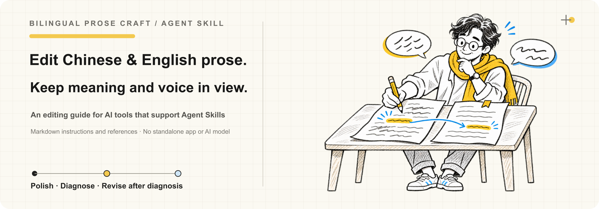
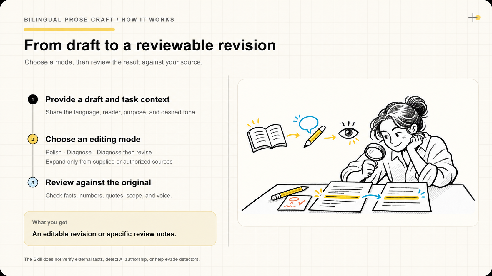

# Bilingual Prose Craft

[简体中文](README.md) | [English](README_EN.md)

AI-generated cover illustration.

**Polish or review Chinese and English writing while preserving its meaning, facts, and voice.**

Bilingual Prose Craft is an Agent Skill: a set of Markdown instructions and reference files for compatible AI tools. It is not standalone software and does not include an AI model.

[Quick start](#quick-start)

## Contents

- [Why use it?](#why)
- [See examples](#examples)
- [Who is it for?](#fit)
- [Quick start](#quick-start)
- [How to use it](#usage)
- [Manage the installation](#manage)
- [Safety and uninstall](#safety)
- [FAQ](#faq)
- [Version and license](#version)
- [Why star this project?](#star)
- [Authenticity reminder](#authenticity)
- [About the maintainer](#about)

## 1. Why use it?

When writing an article, product description, email, or guide, the problem is often not a lack of content. Sentences may be wordy, repeat the same setup, sound like a template, or lose facts and voice during editing.

The Skill considers the text's language, audience, and purpose, then uses relevant Chinese or English editing cues. It treats those cues as prompts for contextual judgment, not rules that require deleting a word, punctuation mark, or sentence pattern.

- **You provide:** a Chinese or English draft and any useful context about its audience, purpose, or tone.
- **The AI can:** polish it, diagnose issues without rewriting, or diagnose and then revise it.
- **You receive:** an editable revision or specific suggestions for the original.
- **You review:** facts, numbers, quotations, tone, and scope against the source. The Skill does not verify external facts.

The references include **26 English writing cues** and **31 Chinese-specific themes plus one shared reader-context check**. Results depend on the draft, instructions, and AI tool; the Skill cannot guarantee that every revision will be better.

## 2. See examples

These are **illustrative examples**, not records of a model run or a claim that every text should be edited this way.

AI-generated workflow illustration, not a product screenshot.

**Chinese**

- Input: “这项工具的设计目标，是希望能够帮助团队成员在报告撰写方面提升效率。”
- Request: “请润色，保留原意，只返回修改稿。”
- Example result: “这项工具旨在帮助团队提高报告撰写效率。”
- Check: Confirm that the claim is still about helping the team write reports more efficiently, then verify it against the product.

**English**

- Input: “The purpose of this feature is to help users to be able to find the information that they need more quickly.”
- Request: “Polish this sentence while preserving its meaning. Return only the revision.”
- Example result: “This feature is designed to help users find the information they need faster.”
- Check: Confirm that the feature, audience, and promised outcome still match the source.

### Four more examples across different topics

**Social media copy**

- Before: “Every evening, I set aside ten minutes to make tea and sit by the window. This small habit helps me slow down and reminds me not to give all my time to work. Finding a way to relax can start with one small thing.”
- After: “Every evening, I make tea and sit by the window for ten minutes. It helps me slow down and reminds me to leave some time for myself. Finding a way to relax can start with one small thing.”

**Product update**

- Before: “This update is designed to give users a smoother and more convenient file-finding experience. Users can now search by file name and filter results by modification date.”
- After: “This update improves file search. You can search by name and filter by modification date.”

**Instructions**

- Before: “If you would like to perform a file import, click the Import button on the Settings page, select a local file, and confirm to complete the import.”
- After: “Open Settings, click Import, select a local file, and confirm.”

**English email**

- Before: “I just wanted to reach out to ask whether we might be able to move Friday's review to 3 p.m., if that would still be convenient for you. Please let me know if this might possibly work.”
- After: “Could we move Friday's review to 3 p.m.? Let me know if that works for you.”

### Long example: a day in Qingyu Town

This original illustrative example follows the before-and-after format of the upstream [Full example](https://github.com/blader/humanizer/blob/v4.0.0/README.md#full-example). It is not a translation of that passage or a real model output.

**Before**

> Last Saturday, my friend and I went to Qingyu Town for an unforgettable seaside trip. We arrived at the station early, full of anticipation. The forecast said rain was possible in the afternoon, so we decided to visit the beach first. The wind was strong and sand got into our shoes; still, the open view made me feel lighter, as if the sea breeze had carried all my worries away.
>
> At noon, we had fish-ball soup at a small shop on the old street. The shop was small, the owner was very welcoming, the soup was delicious, and the fish balls were springy. It was well worth trying. There was not only good food here, but also a warm local spirit. After lunch, we walked past the old pier, a grocery shop, and a stall selling sea salt.
>
> It did start raining in the afternoon, so we ducked into a coffee shop beside the station, ordered two hot drinks, and watched the rain fall on the eaves through the window. The trip taught me that slowing down helps us notice life's little joys. Qingyu Town is not just a town; it is a place where you can find inner peace again.

**After**

> Last Saturday, my friend and I went to Qingyu Town. The forecast called for possible rain in the afternoon, so after arriving early at the station, we went to the beach first. The wind was strong, and sand blew into our shoes. The open view helped me relax.
>
> We had fish-ball soup at a small shop on the old street. The owner was welcoming, the fish balls were springy, and the soup was good. After lunch, we passed the old pier, a grocery shop, and a sea-salt stall.
>
> When it rained in the afternoon, we went to a coffee shop beside the station, ordered two hot drinks, and watched the rain on the eaves. The trip made me want to slow down. I remember the wind by the water, the little shop on the old street, and the rain.

## 3. Who is it for?

### Especially useful for

- AI users and creators editing Chinese or English drafts who want clearer, more natural wording.
- People working on product copy, articles, emails, or guides who need to preserve the original facts and voice.
- Anyone who wants the AI to diagnose issues first, suggest changes without rewriting, or follow a requested output format.
- Polishing AI-generated social media copy to reduce templated phrasing and bring it closer to the writer's voice. This does not identify authorship or guarantee evasion of AI detectors.

### Not a fit, or requires preparation

- Identifying whether a person used AI or bypassing AI detectors: the Skill does neither.
- Independently verifying facts, quotations, or data: the Skill does not automatically check sources.
- Expanding factual content: provide the source material or specify allowed sources; otherwise the Skill avoids inventing facts.
- Using an AI tool without Agent Skills support: follow that tool's instructions to install or provide the guidance.

## 4. Quick start

### Before you begin

- An AI tool that supports Agent Skills. The commands below use Codex; other agents supported by Skills CLI can be selected instead.
- [Node.js 22.20 or newer](https://nodejs.org/en/download/) to run Skills CLI through npx.
- Your AI tool or model provider may charge for usage. This repository does not include a model or API service.

Run this in PowerShell, Terminal, or another command line:

~~~sh
node --version
~~~

Continue if the output is v22.20.0 or newer. If node is not found, install Node.js from its website and reopen the terminal.

### Install and enable

To install the Skill only for the current project, open that project's directory and run:

~~~sh
npx skills add yangjing6213-dev/bilingual-prose-craft --skill bilingual-prose-craft --agent codex
~~~

To make it available to this Windows user across projects, run the global installation command:

~~~sh
npx skills add yangjing6213-dev/bilingual-prose-craft --skill bilingual-prose-craft --agent codex --global
~~~

Follow the CLI prompts to choose an installation method. On Windows, choose Copy if symbolic links are unavailable. To check a global installation:

~~~sh
npx skills ls -g
~~~

When the list shows bilingual-prose-craft, the CLI found the Skill. Start a new Codex session.

#### Have Codex select the Skill automatically for writing tasks

After installing globally, add the text below to Codex's global instructions. On Windows, open the .codex folder inside your user directory in File Explorer, then open or create AGENTS.md and paste the instructions. If AGENTS.override.md already exists in that folder, add the text there because it takes precedence. Save the file and start a new session. These instructions ask Codex to select the installed Skill for matching tasks; they cannot add Agent Skills support to a tool that does not support it.

~~~text
When I ask you to write, rewrite, or polish Chinese or English copy, articles, emails, product descriptions, or social media posts, prefer the installed bilingual-prose-craft Skill.

- If I provide a draft, preserve its facts, meaning, certainty, scope, and writer's voice while polishing it.
- If I ask for a new draft, use only the information I provide, then review it with the Skill. Ask about missing facts or mark them for follow-up.
- Return only the final draft unless I ask for a diagnosis, explanation, or multiple versions.
- Use this only for writing and editing. Do not use it for fact-checking, translation, identifying AI authorship, or evading AI detection.
- If the Skill is not loaded, say so and continue to follow these preservation rules.
~~~

See the [Skills CLI command reference](https://github.com/vercel-labs/skills/blob/main/docs/commands.md#skills-add) for install options and the [Codex guide to global instructions](https://developers.openai.com/codex/guides/agents-md) for setup details.

For a manual Codex installation, copy the entire [skills/bilingual-prose-craft](skills/bilingual-prose-craft) folder to the .agents/skills/bilingual-prose-craft/ directory in your project or the bilingual-prose-craft folder inside %USERPROFILE%/.agents/skills/.

Do not copy only SKILL.md. The Chinese and English editing references in references/ are part of the Skill. See the [Codex documentation](https://developers.openai.com/codex/guides/agents-md).

### Try it once

Send the AI this instruction and a short passage:

~~~text
Please polish this text in English. Preserve its facts, meaning, and my voice. Do not add information. Return only the revision:

[Paste your text here]
~~~

Compare the result with the source. Check names, numbers, dates, quotations, negation, causality, and promises. If the original is already clear, the Skill may leave it alone.

## 5. How to use it

Pair the text with one of these requests:

| Goal | Example request |
|---|---|
| Polish directly | **Polish the following text. Preserve its facts, meaning, and voice. Return only the revision.** |
| Diagnose without rewriting | **Review this text. List the most important issues and suggestions. Do not rewrite it.** |
| Diagnose, then rewrite | **Briefly identify the main issues, then provide a revised version.** |
| See a full process report | **Use the full-report mode: first rewrite, remaining issues, then final polish.** |
| Expand | **Expand this using the materials I provide. Clearly distinguish added facts from the source text.** |
| Write fiction | State that it is fictional, then describe the genre, characters, or plot. |

Mixed Chinese and English text stays in its original languages by default. You can provide a writing sample if you want the AI to match your style. To edit an existing file, ask for a file edit explicitly. The Skill changes prose while preserving code, commands, paths, links, IDs, data, and heading structure as far as possible. Review the result before publishing or using it.

## 6. Manage the installation

| Goal | Command | How to confirm |
|---|---|---|
| List installed Skills | npx skills list | Find bilingual-prose-craft in the list |
| Check for updates | npx skills check | CLI reports whether an update is available |
| Update this Skill | npx skills update bilingual-prose-craft | Run npx skills list afterward |
| Remove a project installation | npx skills remove bilingual-prose-craft | It no longer appears in the project list |
| Remove a global installation | npx skills remove --global bilingual-prose-craft | It no longer appears in the global list |

The location depends on the installation scope. For Codex, project installs are under the project's .agents/skills/bilingual-prose-craft/ directory; Windows user installs are in the bilingual-prose-craft folder inside %USERPROFILE%/.agents/skills/. You usually do not need to edit these files. Use the CLI list command and the agent's own directory documentation to confirm the location.

## 7. Safety and uninstall

### Safety

- The repository contains Markdown instructions and references. It has no executable scripts, model, API keys, or independent data-upload feature.
- How text is transmitted and stored depends on the AI tool and model provider. Do not paste passwords, verification codes, access keys, or private information into public chats or repositories.
- Installation connects to GitHub and uses Skills CLI through npx. See the [Skills CLI documentation](https://github.com/vercel-labs/skills#telemetry) for its anonymous telemetry and data practices.
- The Skill edits files only when asked and is instructed to change prose. Actual file access depends on the AI tool's permissions and execution model.

### Uninstall

From the project where it was installed, run:

~~~sh
npx skills remove bilingual-prose-craft
~~~

If it was installed globally with --global, run:

~~~sh
npx skills remove --global bilingual-prose-craft
~~~

Confirm that the CLI selected this Skill before removing it. Uninstalling it does not remove shared Node.js or Skills CLI installations, other Skills, project files, or personal settings. For a manual installation, remove only the matching bilingual-prose-craft folder after checking its path.

## 8. FAQ

### Why might it make only a few changes?

The original may already be clear, or further changes may be a matter of preference. The Skill may keep a clear sentence rather than rewriting it just to show activity.

### Can it tell whether a person used AI?

No. It reviews expression in context; it does not infer authorship or aim to evade detection.

### Does it verify facts?

Not automatically. It aims to preserve the source's facts and certainty. For fact-checking, provide reliable sources and ask for that task separately.

### How does the Skill review writing?

It treats common writing patterns as contextual cues, not proof of authorship. The English reference has 26 cues grouped into A–F. The first five are clearer structural signals; a single weak cue needs context such as repetition, awkwardness, audience, and the writer's samples. The table below summarizes the groups. Detailed instructions remain in the repository's Chinese and English references.

| Group | Review themes |
|---|---|
| A: Staging instead of stating (1–5) | Negative contrasts used only for emphasis; repetitive or dramatic closers; pseudo-depth; staged run-ups; objections no one raised |
| B: Rhythm by formula (6–11) | Forced triads; repeated openings; dashes as universal connectors; stacked qualifiers; overused hyphens; passive voice or missing subjects |
| C: Inflation and borrowed authority (12–18) | Stock AI vocabulary; inflated significance; vague connections; empty add-ons; sales language replacing facts; borrowed authority; avoiding simple verbs |
| D: Formatting by formula (19–21) | Decorative bold; decorative headings; quotation marks that conflict with the target format |
| E: Chat and drafting residue (22–25) | Chatbot wrappers; repeated knowledge-limit disclaimers and guesses; headings repeated in the first sentence; narrating the document or drafting process |
| F: Reader context and Chinese-specific checks (26, 27–32) | Repeating context the reader already knows, plus six Chinese-specific cues; keep context when the text must stand alone |

The Chinese reference adds six language-specific checks: stacked modifiers using 的, wordy “进行 + verb” phrases, repeated 被 constructions, formulaic four-character phrases, empty “随着……发展” openings, and stock closers. It therefore contains 31 Chinese-specific themes plus the shared reader-context check.

### What editing principles does it follow?

1. Preserve information and certainty first; follow the user's scope and text requirements; match the writer's voice; then address expression.
2. Do not invent features, data, sources, identities, or first-person experiences. Do not turn “may” into “will” or “planned” into “completed.”
3. Preserve negation, conditions, attribution, scope, time, completion status, and real causal links.
4. Triads, four-character phrases, passive voice, dashes, and quotation marks can all be useful. Do not remove them based on form alone.
5. Preserve personal style and the appropriate academic or business register. Do not translate mixed Chinese and English text by default.
6. When editing files, preserve code, commands, paths, link targets, YAML, data, headings, and anchors. If headings or structure change, check references to them.
7. Return only the final draft by default; do not require intermediate drafts, hit counts, or self-ratings.

The principles and categories draw on [blader/humanizer's 26 writing cues](https://github.com/blader/humanizer/blob/v4.0.0/README.md#the-26-patterns). This project retains the source's MIT notice in [Third-Party Notices](THIRD_PARTY_NOTICES.md).

### Why doesn't this README force Microsoft YaHei?

GitHub renders Markdown using its own page styles, so a repository cannot reliably choose the font on every visitor's device. The prose uses consistent Markdown formatting without extra font tags, while command examples remain in copyable code blocks. Whether Microsoft YaHei is available depends on the visitor's device and browser. See [GitHub's Markdown documentation](https://docs.github.com/en/get-started/writing-on-github/getting-started-with-writing-and-formatting-on-github/basic-writing-and-formatting-syntax).

### What if the Skill does not appear after installation?

Run npx skills list and check that it was installed for the current agent and project scope. Then start a new session or refresh the Skill list as the tool requires. Support and directories vary by agent; see the [Skills CLI documentation](https://github.com/vercel-labs/skills) and the agent's own guide.

### Does using it cost money?

The repository contains Markdown files and no AI model. Any model or service charges come from the AI tool and provider you choose.

## 9. Version and license

- The Skill files currently show version 1.0.0. There is no separate changelog; see the GitHub commit history for later changes.
- This project uses the [MIT License](LICENSE).
- This Skill integrates material from other MIT-licensed Skills. Keep the [Third-Party Notices](THIRD_PARTY_NOTICES.md) and original license information with copies.

## 10. ⭐ Why star this project?

If you ask AI to edit different kinds of Chinese and English drafts, reusable editing steps and references can save you from explaining the same requirements each time.

If this project helps, a star makes it easier to find again and encourages continued maintenance.

## 11. Authenticity reminder

Confirm project and maintainer information through this repository and the [Enhe ENHE AI website](https://www.enhe-tech.com.cn/). If someone claiming to represent the project or maintainer asks for payment or account access, verify the request through the website or contact details below. Do not share passwords, verification codes, or access keys with strangers.

## 12. About the maintainer

### Maintainer

**Enhe (恩禾) | Product Designer · Solo Business Builder · AI Builder**

Building a one-person company with AI.

- GitHub: [yangjing6213-dev](https://github.com/yangjing6213-dev)
- X / Twitter: [Amenenhe_ai](https://x.com/Amenenhe_ai)
- Website: [Enhe ENHE AI](https://www.enhe-tech.com.cn/)
- WeChat: Hu-Amen
- Email: [amen.enhe@gmail.com](mailto:amen.enhe@gmail.com)

Enhe (恩禾) led the integration and writing of this Skill with AI assistance. Sources and rights information are listed in [THIRD_PARTY_NOTICES.md](THIRD_PARTY_NOTICES.md).

### Related projects

- [blader/humanizer](https://github.com/blader/humanizer): source project for English editing cues.
- [op7418/Humanizer-zh](https://github.com/op7418/Humanizer-zh): source project for Chinese editing cues.

### Learn more

I organized editing methods for Chinese and English into this reusable Skill for AI writing and everyday work. Visit the [Enhe ENHE AI website](https://www.enhe-tech.com.cn/) for more on AI tools, Skills, and industry updates.
